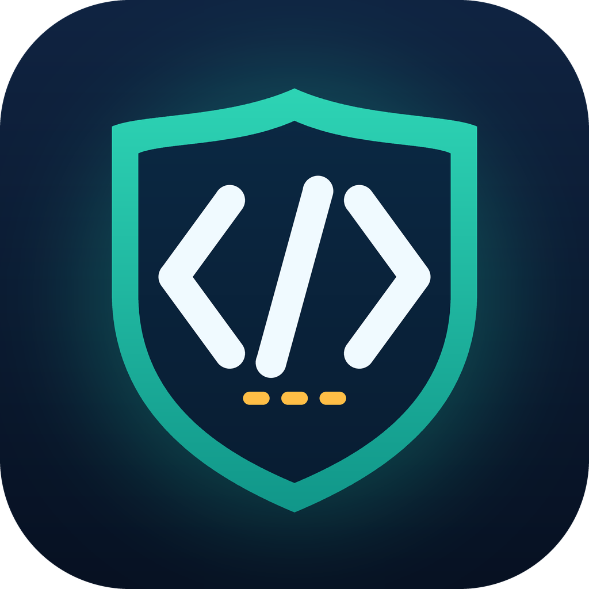

**Read this in your language:** **[Português (Brasil)](docs/README.pt-BR.md)** · **[Español](docs/README.es.md)** · English (you are here)

<p align="center"></p>

# Principal SecOps Dev & Token Optimizer

[](https://github.com/alexccastilho/principal-secops-dev-token-optimizer/actions/workflows/tests.yml) [](https://github.com/alexccastilho/principal-secops-dev-token-optimizer/actions/workflows/codeql.yml) [](https://github.com/alexccastilho/principal-secops-dev-token-optimizer/releases/latest) [](LICENSE)

A skill for **Claude Code** and **claude.ai** that makes Claude work as a senior security engineer (SecOps) serving someone who **does not program**. It delivers secure, working code that stays easy to change, explains it in plain Brazilian Portuguese, and keeps each delivery the size the request needs.

**Author:** Alex Camacho Castilho ([@alexccastilho](https://github.com/alexccastilho)) · **License:** [MIT](LICENSE)

> The skill answers its users in Brazilian Portuguese (pt-BR), because that is the audience it was built for. Its instructions are written in English, and this documentation is available in English, Portuguese and Spanish.

## What it does

- **Secure by default.** Without being asked, it applies a baseline aligned with the OWASP Top 10:2025, ASVS 5.0 and Brazil's LGPD: parameterized queries, Argon2id or bcrypt for passwords, secrets out of the code, server-side access control and errors that do not leak details.
- **Never breaks what already works.** It reads files before editing, touches only what the request needs, keeps contracts intact (routes, columns, JSON shapes) and asks before any destructive action.
- **Keeps the code from getting messy.** Before writing, it asks "what has to change together with this?". It does not copy logic, does not tie modules that change for different reasons, does not patch a bug with an `if` for one value, and writes tests that catch real regressions. New in 2.1.0.
- **Talks to people who do not program.** Answers come in clear pt-BR: where the file goes, which command to run, and how to test both the success case and the failure case.
- **Proportional delivery.** It writes only the files the request needs, sends only the changed blocks, loads its references on demand and batches its turns. Token use is measured in the benchmark, not promised.
- **Looks versions and known flaws up live.** `scripts/fontes.py` reads the support status of the version in use from endoflife.date and the known flaws of the project's locked dependencies from OSV, flagging the ones in CISA's actively exploited list. New facts arrive without a new release of the skill. New in 2.3.0.
- **Checks before delivering.** It ships with `scripts/revisar_codigo.py` (Python 3.8+, standard library only, 77 rules over 151 file types), which looks for secrets in code, SQL built from text, weak hashing, unescaped output, `eval`/`exec`, shell commands built from data, disabled TLS checks and memory traps in C, C++ and Rust. With `--entrega` it also checks that the project has the pieces to run as delivered (New in 2.3.0).
- **Maintains legacy systems instead of rewriting them.** Delphi, Clipper/Harbour, VB6, FoxPro, COBOL, VBA: back up first, make it safe where it stands, migrate in stages. New in 2.2.0.

## Two modes

**Normal mode** is automatic. It covers everyday work: a new feature, a bug fix, a security review, a project from scratch. It follows the minimal scope rule: in an existing system it never rearranges the code around the change. The structure rules apply to what it writes ("do not make it worse"), and when a cleaner layout would need wider changes, it says so in one line and offers.

**Refactor mode** runs only on explicit request: the `/secops-refatorar` command in Claude Code, or a request like "refatore o projeto inteiro" in claude.ai. It is for a project that is already tangled. It lists every coupling problem, redesigns from first principles, fixes everything and checks again until nothing worth fixing is left, with guardrails that never relax:

- it requires Git, a clean working tree and a branch of its own;
- public contracts (routes, columns, JSON shapes, environment variables) stay identical;
- security code is never treated as surplus: duplicated permission checks are centralized, never dropped;
- no dependency is upgraded during the refactor;
- the scanner runs at the end, and the final report is in plain pt-BR, with how to accept or undo.

Optional additions, chosen at the start: remove comments that only restate the code, and prune tests that would not catch a real bug (security tests and regression tests always stay).

## What it does not do

- **It is not a penetration test or a professional audit.** The scanner reads code line by line with patterns; it does not follow data across files, run the app or attack it. A clean scan proves nothing by itself.
- **It does not rewrite or reorganize what you did not ask for.** In normal mode it touches only what the request needs. A full refactor runs only in refactor mode, on explicit request, on its own Git branch.
- **It does not upgrade dependencies or language versions on its own,** and never states a version, end-of-life date or "latest" from memory: it checks the official source first and says when it checked.
- **It does not deploy, push, delete data or run destructive commands** without asking first.
- **It is not legal advice.** For LGPD, GPL or CRA it applies the published rules and points to the source; a lawyer decides the edge cases.
- **It does not answer in other languages.** Conversation is in Brazilian Portuguese; code identifiers and comments stay in English.
- **Scanner limits:** files over 1 MB and binaries are skipped; lines over 500 characters get only the secret rules; Jupyter notebooks are read as JSON text, so only the language-neutral rules apply to them.
- **It never prints or stores a secret.** A secret found in code is reported with the line hidden.

## Coverage

| Area | References |
|---|---|
| Web | PHP (WordPress, Laravel, Symfony), Node.js and TypeScript (Express, Fastify, NestJS, Next.js, Deno, Bun), Python (Django, FastAPI, Flask), Java (Spring Boot, Jakarta EE, Quarkus), HTML, CSS, accessibility, CSP |
| Relational databases | MySQL and MariaDB, PostgreSQL and Supabase, SQLite, SQL Server, Oracle, Firebird, Db2, DuckDB, CockroachDB, Access, DBF/Paradox |
| NoSQL and vector | MongoDB, Redis/Valkey, Firebase, DynamoDB, Cassandra/ScyllaDB, Elasticsearch/OpenSearch, Neo4j, ClickHouse, InfluxDB, vector databases and RAG |
| Legacy and business | Delphi, Free Pascal/Lazarus, Pascal, Clipper/Harbour, Visual FoxPro, VB6, COBOL, RPG, OpenEdge, PowerBuilder, ABAP |
| Scripts and automation | Lua, Perl, VBA and Office/Access macros, Google Apps Script, PowerShell, Bash/shell, .bat/.cmd, AutoHotkey, Tcl |
| Data and science | R, Julia, MATLAB/Octave, Fortran, SAS, Jupyter, pandas/Polars, CSV/Excel export, LGPD in datasets |
| Other languages and mobile | Go, C#/F#/VB.NET, Ruby/Rails, Kotlin, Swift, Dart/Flutter, Scala, Elixir/Erlang, Clojure, Haskell, OCaml, Groovy/Jenkins, Crystal, Android, iOS, React Native |
| Native and systems | C, C++, Rust, Zig, Ada/SPARK, Assembly, Objective-C, D, Nim, CMake, hardening flags, sanitizers, fuzzing |
| Desktop and GUI | toolkit choice, Qt 6, Slint, Avalonia, GTK, Flutter, Tauri, Electron, visual design |
| Structure | where code lives, coupling, special cases, tests that guard behavior, full refactor |
| Process | project from scratch, diagnosing errors, versions and sources, compliance (GPL, SBOM, CRA) |

## Installation

### Claude Code: plugin marketplace (recommended)

Inside a Claude Code session:

```
/plugin marketplace add alexccastilho/principal-secops-dev-token-optimizer
/plugin install principal-secops-dev-token-optimizer@alexccastilho-skills
```

Or from the terminal:

```bash
claude plugin marketplace add alexccastilho/principal-secops-dev-token-optimizer
claude plugin install principal-secops-dev-token-optimizer@alexccastilho-skills --scope user
```

The skill starts on its own when a request matches it. The plugin also brings the `/secops-refatorar` command for refactor mode (full name `/principal-secops-dev-token-optimizer:secops-refatorar`, if another plugin uses the short one). To update: `/plugin marketplace update alexccastilho-skills`.

### Claude Code: manual copy

```bash
git clone https://github.com/alexccastilho/principal-secops-dev-token-optimizer.git
# Linux or macOS
cp -r principal-secops-dev-token-optimizer/skills/principal-secops-dev-token-optimizer ~/.claude/skills/
```

```powershell
# Windows (PowerShell)
Copy-Item -Recurse principal-secops-dev-token-optimizer\skills\principal-secops-dev-token-optimizer "$env:USERPROFILE\.claude\skills\"
```

Restart Claude Code after copying. A manual copy does not include the `/secops-refatorar` command; ask for refactor mode in words instead.

### claude.ai (web, desktop and app)

1. Download `principal-secops-dev-token-optimizer-vX.Y.Z.zip` from the [Releases](https://github.com/alexccastilho/principal-secops-dev-token-optimizer/releases/latest) page.
2. In claude.ai, open **Customize > Skills** and upload the ZIP without unpacking it.
3. Turn the skill on. Code execution must be enabled in the settings for the scanner to run; without it, the skill does the same checks by reading the code.

To build the ZIP yourself: `python tools/build_zip.py` (it goes to `dist/`).

## Usage

You do not need to name the skill. A few requests that trigger it, as a person who does not program would write them:

| You write | The skill |
|---|---|
| "preciso de uma tela de login pro meu site, tenho cPanel" | picks PHP and MySQL for your hosting, delivers secure code and a step-by-step test |
| "deu erro 500 depois que mexi no formulário" | asks for one thing (the log), finds the cause, fixes it there and nowhere else |
| "o pedido 1834 sai com desconto em dobro" | fixes the discount rule, not the one order |
| "é seguro publicar?" | audits against the security baseline and reports by severity |
| "esse código tá bagunçado" | stays in normal mode and offers refactor mode in one line |
| `/secops-refatorar módulo de pedidos` | explains refactor mode, asks which additions to run, waits for your "pode" |

## The scanner

The skill runs the scanner on what it wrote before delivering. You can also run it yourself, or in CI:

```bash
python3 skills/principal-secops-dev-token-optimizer/scripts/revisar_codigo.py <file-or-folder>
python3 skills/principal-secops-dev-token-optimizer/scripts/revisar_codigo.py --json <file-or-folder>
python3 skills/principal-secops-dev-token-optimizer/scripts/revisar_codigo.py --entrega <project-folder>
```

Exit code 0 means no HIGH finding, 1 means at least one HIGH, and 2 means the path was wrong or nothing was readable, which is not a pass. It never prints a secret value: the excerpt is hidden for the whole line. A clean scan proves nothing by itself; the skill's checklist still applies.

## Benchmark

The same small app (contacts with login and SQLite) was requested 36 times through Claude Code, with and without the skill, in PHP, Python, Node.js, Java, C# and Go, in an isolated configuration. In a blind review, the app built with the skill was the more secure one in all 6 languages, and it always came with run instructions. The cost: about 3 times the price and 2.5 times the time per app (USD 0.58 against 0.20, 176 s against 69 s), and 16 of 18 apps compiled, against 18 of 18 without it. Full tables, method, limits and how to reproduce: [docs/BENCHMARK.md](docs/BENCHMARK.md). Version 2.3.0 was measured against 2.2.1 (partial, three languages): it loads for every kind of code request, was not more expensive than 2.2.1 per app or per review (a small bug fix costs USD 0.04 more, because the skill now loads for it), and its apps were rated as secure or more and easier to run: [docs/BENCHMARK-2.3.md](docs/BENCHMARK-2.3.md).

## Repository layout

```
.claude-plugin/
  marketplace.json         # marketplace catalog (Claude Code)
  plugin.json              # plugin manifest, with version and authorship
  icon.png                 # plugin icon
commands/
  secops-refatorar.md      # /secops-refatorar command (refactor mode)
skills/principal-secops-dev-token-optimizer/
  SKILL.md                 # main instructions
  references/              # guides loaded on demand (stacks, structure, refactor mode)
  scripts/revisar_codigo.py  # scanner run before delivery
  scripts/fontes.py        # live versions and known flaws (endoflife.date, OSV, CISA KEV)
  fontes/registro.json     # addresses of the official sources per technology
  evals/evals.json         # evaluation scenarios
  THIRD_PARTY_NOTICES.md   # credits and licenses of adapted work
tests/                     # test suite (standard library unittest)
tools/build_zip.py         # builds the claude.ai ZIP
tools/make_icon.py         # draws the plugin icon (needs Pillow)
benchmark/                 # with/without-skill benchmark (run_benchmark.py, analyze.py, results/)
docs/                      # translations, BENCHMARK and the v2.0.0 review report (in Portuguese)
docs/research/             # evidence logs for 2.2.0: one line per verified fact, with URL and date
```

## Development

The test suite needs only Python 3.8 or newer:

```bash
python -B -m unittest discover -s tests -v
```

It checks the scanner's behavior, that versions agree across the manifest, `SKILL.md` and the three changelogs, that every reference is routed from `SKILL.md`, that the evals are well formed, that the three translations exist and link correctly, the docs style rules and the contents of the claude.ai ZIP. GitHub Actions runs it on Linux and Windows at every push, and CodeQL scans the Python and the workflows. How to contribute is in [CONTRIBUTING.md](CONTRIBUTING.md); how to report a vulnerability, in [SECURITY.md](SECURITY.md).

## Versioning

The project follows [SemVer](https://semver.org/). What changed in each version is in the [CHANGELOG](CHANGELOG.md).

## Credits and license

Created and maintained by **Alex Camacho Castilho**, under the [MIT License](LICENSE). If you use, adapt or redistribute it, keep the copyright notice.

The structure rules and refactor mode adapt ideas from [`untangle-codebase` and `prune-tests`](https://github.com/caldoai/skills) by Maze (MIT). Details and the full license text are in [THIRD_PARTY_NOTICES.md](skills/principal-secops-dev-token-optimizer/THIRD_PARTY_NOTICES.md).
