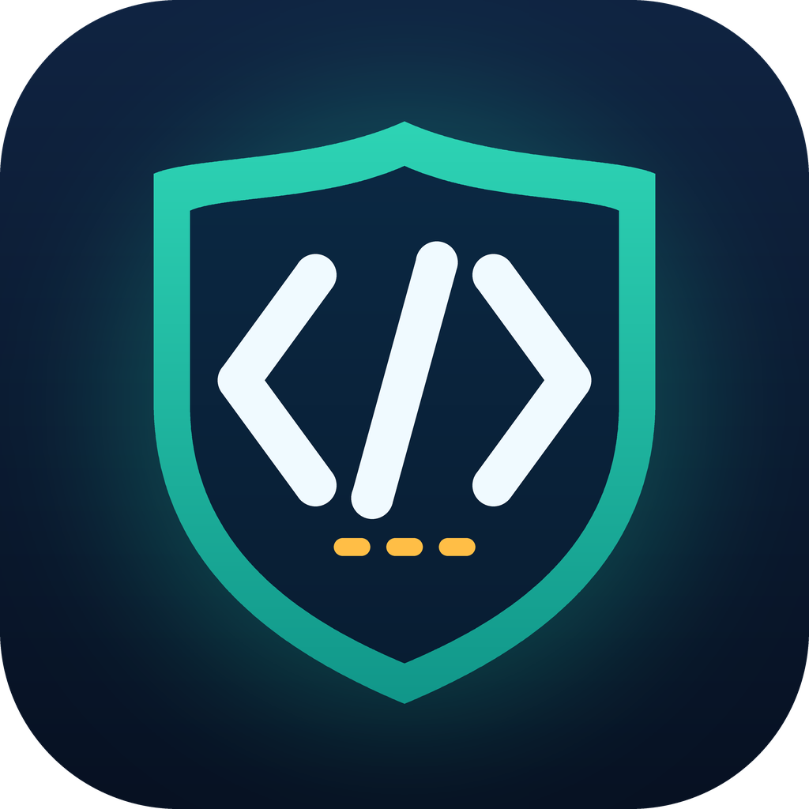

**Léelo en tu idioma:** **[Português (Brasil)](README.pt-BR.md)** · Español (estás aquí) · **[English](../README.md)**

<p align="center"></p>

# Principal SecOps Dev & Token Optimizer

[](https://github.com/alexccastilho/principal-secops-dev-token-optimizer/actions/workflows/tests.yml) [](https://github.com/alexccastilho/principal-secops-dev-token-optimizer/actions/workflows/codeql.yml) [](https://github.com/alexccastilho/principal-secops-dev-token-optimizer/releases/latest) [](../LICENSE)

Skill para **Claude Code** y **claude.ai** que hace que Claude trabaje como un desarrollador sénior de seguridad (SecOps) que atiende a una persona que **no programa**. Entrega código seguro, que funciona y sigue siendo fácil de cambiar, lo explica en portugués sencillo y gasta el mínimo de tokens.

**Autor:** Alex Camacho Castilho ([@alexccastilho](https://github.com/alexccastilho)) · **Licencia:** [MIT](../LICENSE)

> La skill responde en portugués de Brasil (pt-BR), porque ese es el público para el que fue creada. Sus instrucciones están escritas en inglés, y esta documentación está disponible en inglés, portugués y español.

## Qué hace

- **Seguridad por defecto.** Sin que se lo pidan, aplica una línea base alineada con el OWASP Top 10:2025, el ASVS 5.0 y la LGPD brasileña: consultas parametrizadas, contraseñas con Argon2id o bcrypt, secretos fuera del código, control de acceso en el servidor y errores que no filtran detalles.
- **No rompe lo que ya funciona.** Lee los archivos antes de editarlos, toca solo lo que el pedido necesita, mantiene intactos los contratos (rutas, columnas, formatos JSON) y pide confirmación antes de cualquier acción destructiva.
- **Evita que el código se vuelva un desorden.** Antes de escribir, se pregunta "¿qué tiene que cambiar junto con esto?". No copia lógica, no ata módulos que cambian por motivos distintos, no corrige un error con un `if` para un solo valor y escribe pruebas que detectan regresiones reales. Novedad de la 2.1.0.
- **Habla el idioma de quien no programa.** Las respuestas llegan en pt-BR claro: dónde va el archivo, qué comando ejecutar y cómo probar el caso correcto y el caso de error.
- **Ahorra tokens.** Envía solo los bloques que cambiaron, carga sus referencias bajo demanda y respeta un límite de archivos por tarea.
- **Consulta las versiones en vez de adivinar.** Lee la versión que usa el proyecto y verifica el estado de soporte actual, en lugar de confiar en la memoria del modelo.
- **Verifica antes de entregar.** Incluye el escáner `scripts/revisar_codigo.py` (Python 3.8+, solo biblioteca estándar, 77 reglas sobre 151 tipos de archivo), que busca secretos en el código, SQL armado con texto, hash débil, salida sin escapar, `eval`/`exec`, comandos del sistema armados con datos, verificación TLS desactivada y trampas de memoria en C, C++ y Rust.
- **Mantiene sistemas heredados en lugar de reescribirlos.** Delphi, Clipper/Harbour, VB6, FoxPro, COBOL, VBA: primero la copia de seguridad, seguridad donde está, migración por etapas. Novedad de la 2.2.0.

## Dos modos

**El modo normal** es automático. Cubre el trabajo diario: una funcionalidad nueva, la corrección de un error, una revisión de seguridad, un proyecto desde cero. Sigue la regla del alcance mínimo: en un sistema existente nunca reorganiza el código alrededor del cambio. Las reglas de estructura valen para lo que escribe ("no lo empeores"), y cuando una organización mejor exigiría cambios más amplios, lo dice en una línea y lo ofrece.

**El modo refactorización** solo se ejecuta con un pedido explícito: el comando `/secops-refatorar` en Claude Code, o un pedido como "refatore o projeto inteiro" en claude.ai. Es para un proyecto que ya está enredado. Enumera todos los problemas de acoplamiento, rediseña desde los principios, corrige todo y vuelve a revisar hasta que no quede nada que valga la pena corregir, con protecciones que nunca se relajan:

- exige Git, todo guardado y una rama propia;
- los contratos públicos (rutas, columnas, formatos JSON, variables de entorno) quedan idénticos;
- el código de seguridad nunca se trata como sobrante: las comprobaciones de permisos repetidas se centralizan, nunca se eliminan;
- ninguna dependencia se actualiza durante la refactorización;
- el escáner se ejecuta al final, y el informe final llega en pt-BR sencillo, con cómo aceptar o deshacer.

Extras opcionales, elegidos al inicio: quitar comentarios que solo repiten el código y podar pruebas que no detectarían un error real (las pruebas de seguridad y de regresión se quedan siempre).

## Qué no hace

- **No es una prueba de penetración ni una auditoría profesional.** El escáner lee el código línea por línea con patrones; no sigue los datos entre archivos ni ejecuta o ataca el sistema. Un análisis limpio no prueba nada por sí solo.
- **No reescribe ni reorganiza lo que no pediste.** En modo normal toca solo lo que el pedido necesita. La refactorización completa solo ocurre en modo refactorización, con pedido explícito, en una rama propia de Git.
- **No actualiza dependencias ni versiones por su cuenta,** y nunca afirma una versión, una fecha de fin de soporte o "la más reciente" de memoria: consulta la fuente oficial antes y dice cuándo la consultó.
- **No publica, no hace push, no borra datos ni ejecuta comandos destructivos** sin preguntar antes.
- **No es asesoría legal.** Para LGPD, GPL o CRA aplica las reglas publicadas y señala la fuente; los casos límite los decide un abogado.
- **No responde en otros idiomas.** La conversación es en portugués de Brasil; los identificadores y comentarios del código quedan en inglés.
- **Límites del escáner:** los archivos de más de 1 MB y los binarios se omiten; las líneas de más de 500 caracteres solo reciben las reglas de secretos; los notebooks de Jupyter se leen como texto JSON, así que solo se les aplican las reglas que valen para cualquier lenguaje.
- **Nunca imprime ni guarda un secreto.** Un secreto encontrado en el código se informa con la línea oculta.

## Cobertura

| Área | Referencias |
|---|---|
| Web | PHP (WordPress, Laravel, Symfony), Node.js y TypeScript (Express, Fastify, NestJS, Next.js, Deno, Bun), Python (Django, FastAPI, Flask), Java (Spring Boot, Jakarta EE, Quarkus), HTML, CSS, accesibilidad, CSP |
| Bases de datos relacionales | MySQL y MariaDB, PostgreSQL y Supabase, SQLite, SQL Server, Oracle, Firebird, Db2, DuckDB, CockroachDB, Access, DBF/Paradox |
| NoSQL y vectoriales | MongoDB, Redis/Valkey, Firebase, DynamoDB, Cassandra/ScyllaDB, Elasticsearch/OpenSearch, Neo4j, ClickHouse, InfluxDB, bases vectoriales y RAG |
| Heredados y sistemas de gestión | Delphi, Free Pascal/Lazarus, Pascal, Clipper/Harbour, Visual FoxPro, VB6, COBOL, RPG, OpenEdge, PowerBuilder, ABAP |
| Scripts y automatización | Lua, Perl, VBA y macros de Office/Access, Google Apps Script, PowerShell, Bash/shell, .bat/.cmd, AutoHotkey, Tcl |
| Datos y ciencia | R, Julia, MATLAB/Octave, Fortran, SAS, Jupyter, pandas/Polars, exportación CSV/Excel, LGPD en conjuntos de datos |
| Otros lenguajes y móvil | Go, C#/F#/VB.NET, Ruby/Rails, Kotlin, Swift, Dart/Flutter, Scala, Elixir/Erlang, Clojure, Haskell, OCaml, Groovy/Jenkins, Crystal, Android, iOS, React Native |
| Nativo y sistemas | C, C++, Rust, Zig, Ada/SPARK, Assembly, Objective-C, D, Nim, CMake, flags de hardening, sanitizers, fuzzing |
| Escritorio y GUI | elección del toolkit, Qt 6, Slint, Avalonia, GTK, Flutter, Tauri, Electron, diseño visual |
| Estructura | dónde vive el código, acoplamiento, casos especiales, pruebas que protegen el comportamiento, refactorización completa |
| Proceso | proyecto desde cero, diagnóstico de errores, versiones y fuentes, cumplimiento (GPL, SBOM, CRA) |

## Instalación

### Claude Code: marketplace de plugins (recomendado)

Dentro de una sesión de Claude Code:

```
/plugin marketplace add alexccastilho/principal-secops-dev-token-optimizer
/plugin install principal-secops-dev-token-optimizer@alexccastilho-skills
```

O desde la terminal:

```bash
claude plugin marketplace add alexccastilho/principal-secops-dev-token-optimizer
claude plugin install principal-secops-dev-token-optimizer@alexccastilho-skills --scope user
```

La skill se activa sola cuando el pedido coincide con ella. El plugin también trae el comando `/secops-refatorar`, del modo refactorización (nombre completo `/principal-secops-dev-token-optimizer:secops-refatorar`, si otro plugin usa el nombre corto). Para actualizar: `/plugin marketplace update alexccastilho-skills`.

### Claude Code: copia manual

```bash
git clone https://github.com/alexccastilho/principal-secops-dev-token-optimizer.git
# Linux o macOS
cp -r principal-secops-dev-token-optimizer/skills/principal-secops-dev-token-optimizer ~/.claude/skills/
```

```powershell
# Windows (PowerShell)
Copy-Item -Recurse principal-secops-dev-token-optimizer\skills\principal-secops-dev-token-optimizer "$env:USERPROFILE\.claude\skills\"
```

Reinicia Claude Code después de copiar. La copia manual no incluye el comando `/secops-refatorar`; pide el modo refactorización con palabras.

### claude.ai (web, escritorio y app)

1. Descarga `principal-secops-dev-token-optimizer-vX.Y.Z.zip` desde la página de [Releases](https://github.com/alexccastilho/principal-secops-dev-token-optimizer/releases/latest).
2. En claude.ai, abre **Customize > Skills** y sube el ZIP sin descomprimirlo.
3. Activa la skill. La ejecución de código debe estar habilitada en la configuración para que el escáner funcione; sin ella, la skill hace las mismas comprobaciones leyendo el código.

Para generar el ZIP tú mismo: `python tools/build_zip.py` (sale en `dist/`).

## Uso

No hace falta nombrar la skill. Algunos pedidos que la activan, tal como los escribiría quien no programa (en portugués, el idioma de su público):

| Escribes | La skill |
|---|---|
| "preciso de uma tela de login pro meu site, tenho cPanel" | elige PHP y MySQL por tu hosting, entrega código seguro y una prueba paso a paso |
| "deu erro 500 depois que mexi no formulário" | pide una sola cosa (el log), encuentra la causa y la corrige allí, sin tocar el resto |
| "o pedido 1834 sai com desconto em dobro" | corrige la regla del descuento, no ese pedido |
| "é seguro publicar?" | audita contra la línea base de seguridad e informa por gravedad |
| "esse código tá bagunçado" | sigue en modo normal y ofrece el modo refactorización en una línea |
| `/secops-refatorar módulo de pedidos` | explica el modo refactorización, pregunta qué extras hacer y espera tu "pode" |

## El escáner

La skill ejecuta el escáner sobre lo que escribió antes de entregar. También puedes ejecutarlo por tu cuenta, o en un CI:

```bash
python3 skills/principal-secops-dev-token-optimizer/scripts/revisar_codigo.py <archivo-o-carpeta>
python3 skills/principal-secops-dev-token-optimizer/scripts/revisar_codigo.py --json <archivo-o-carpeta>
```

El código de salida 0 significa ningún hallazgo HIGH, 1 significa al menos un HIGH, y 2 significa ruta equivocada o nada legible, lo que no es una aprobación. Nunca imprime el valor de un secreto: el fragmento se oculta en toda la línea. Un análisis limpio no prueba nada por sí solo; la lista de comprobación de la skill sigue vigente.

## Benchmark

La misma app pequeña (contactos con login y SQLite) se pidió a Claude Code con y sin la skill, en PHP, Python, Node.js, Java, C# y Go, en una configuración limpia, sin otros plugins. Tokens, tiempo, costo, líneas de código, compilación y hallazgos de seguridad se comparan en [BENCHMARK.es.md](BENCHMARK.es.md), junto con el método y cómo reproducirlo.

## Estructura del repositorio

```
.claude-plugin/
  marketplace.json         # catálogo del marketplace (Claude Code)
  plugin.json              # manifiesto del plugin, con versión y autoría
  icon.png                 # icono del plugin
commands/
  secops-refatorar.md      # comando /secops-refatorar (modo refactorización)
skills/principal-secops-dev-token-optimizer/
  SKILL.md                 # instrucciones principales
  references/              # guías cargadas bajo demanda (stacks, estructura, modo refactorización)
  scripts/revisar_codigo.py  # escáner usado antes de la entrega
  evals/evals.json         # escenarios de evaluación
  THIRD_PARTY_NOTICES.md   # créditos y licencias de trabajos adaptados
tests/                     # suite de pruebas (unittest de la biblioteca estándar)
tools/build_zip.py         # genera el ZIP para claude.ai
tools/make_icon.py         # dibuja el icono del plugin (necesita Pillow)
benchmark/                 # benchmark con y sin la skill (run_benchmark.py, analyze.py, results/)
docs/                      # traducciones, BENCHMARK y el informe de revisión de la v2.0.0 (en portugués)
docs/research/             # registros de evidencia de la 2.2.0: un dato verificado por línea, con URL y fecha (en inglés)
```

## Desarrollo

La suite de pruebas solo necesita Python 3.8 o más reciente:

```bash
python -B -m unittest discover -s tests -v
```

Comprueba el comportamiento del escáner, que la versión coincida entre el manifiesto, el `SKILL.md` y los tres changelogs, que cada referencia esté enlazada desde el `SKILL.md`, que los evals estén bien formados, que las tres traducciones existan y se enlacen correctamente, las reglas de estilo de la documentación y el contenido del ZIP de claude.ai. GitHub Actions la ejecuta en Linux y en Windows en cada push, y CodeQL analiza el Python y los workflows. Cómo contribuir está en [CONTRIBUTING.es.md](CONTRIBUTING.es.md); cómo informar de una vulnerabilidad, en [SECURITY.md](../SECURITY.md).

## Versionado

El proyecto sigue [SemVer](https://semver.org/lang/es/). Lo que cambió en cada versión está en el [CHANGELOG](CHANGELOG.es.md).

## Créditos y licencia

Creado y mantenido por **Alex Camacho Castilho**, bajo la [Licencia MIT](../LICENSE). Si lo usas, adaptas o redistribuyes, conserva el aviso de copyright.

Las reglas de estructura y el modo refactorización adaptan ideas de [`untangle-codebase` y `prune-tests`](https://github.com/caldoai/skills), de Maze (MIT). Los detalles y el texto completo de la licencia están en [THIRD_PARTY_NOTICES.md](../skills/principal-secops-dev-token-optimizer/THIRD_PARTY_NOTICES.md).
