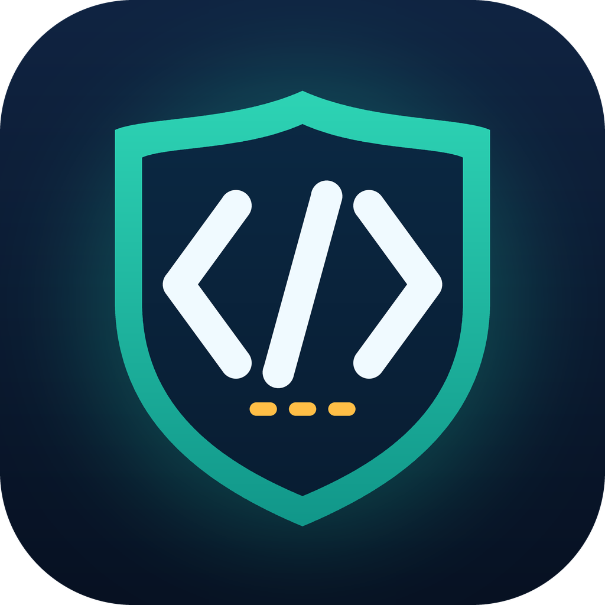

**Leia no seu idioma:** Português (Brasil) (você está aqui) · **[Español](README.es.md)** · **[English](../README.md)**

<p align="center"></p>

# Principal SecOps Dev & Token Optimizer

[](https://github.com/alexccastilho/principal-secops-dev-token-optimizer/actions/workflows/tests.yml) [](https://github.com/alexccastilho/principal-secops-dev-token-optimizer/actions/workflows/codeql.yml) [](https://github.com/alexccastilho/principal-secops-dev-token-optimizer/releases/latest) [](../LICENSE)

Skill para **Claude Code** e **claude.ai** que faz o Claude trabalhar como um desenvolvedor sênior de segurança (SecOps) atendendo uma pessoa que **não programa**. Ele entrega código seguro, que funciona e continua fácil de mudar, explica em português simples e mantém cada entrega do tamanho que o pedido precisa.

**Autor:** Alex Camacho Castilho ([@alexccastilho](https://github.com/alexccastilho)) · **Licença:** [MIT](../LICENSE)

> A skill responde em português do Brasil, porque esse é o público para quem ela foi feita. As instruções internas estão em inglês, e esta documentação existe em inglês, português e espanhol.

## O que a skill faz

- **Segurança por padrão.** Aplica, sem precisar pedir, uma linha de base alinhada ao OWASP Top 10:2025, ao ASVS 5.0 e à LGPD: consultas parametrizadas, senhas com Argon2id ou bcrypt, segredos fora do código, controle de acesso no servidor e erros que não vazam detalhes.
- **Não quebra o que já funciona.** Lê os arquivos antes de editar, mexe só no necessário, preserva contratos (rotas, colunas, formatos JSON) e pede confirmação antes de qualquer ação destrutiva.
- **Não deixa o código virar bagunça.** Antes de escrever, pergunta "o que muda junto com isto?". Não copia lógica, não amarra módulos que mudam por motivos diferentes, não corrige bug com um `if` para um valor só e escreve testes que pegam regressões de verdade. Novidade da 2.1.0.
- **Fala a língua de quem não programa.** As respostas vêm em pt-BR claro: onde colocar o arquivo, qual comando rodar e como testar o caso certo e o caso de erro.
- **Entrega proporcional.** Escreve só os arquivos que o pedido precisa, manda só os trechos que mudaram, carrega as referências por demanda e agrupa as rodadas. O gasto de tokens é medido no benchmark, não prometido.
- **Consulta versões e falhas conhecidas na hora.** O `scripts/fontes.py` lê no endoflife.date o status de suporte da versão em uso e no OSV as falhas conhecidas das dependências travadas do projeto, marcando as que estão na lista de exploradas ativamente da CISA. Fato novo chega sem nova versão da skill. Novidade da 2.3.0.
- **Verifica antes de entregar.** Traz o scanner `scripts/revisar_codigo.py` (Python 3.8+, só biblioteca padrão, 77 regras em 153 tipos de arquivo), que procura segredos no código, SQL montado com texto, hash fraco, saída sem escape, `eval`/`exec`, comandos de sistema montados com dado, verificação TLS desligada e armadilhas de memória em C, C++ e Rust. Com `--entrega`, confere também se o projeto tem as peças para rodar como entregue (novidade da 2.3.0).
- **Mantém sistema legado em vez de reescrever.** Delphi, Clipper/Harbour, VB6, FoxPro, COBOL, VBA: backup primeiro, segurança onde ele está, migração em etapas. Novidade da 2.2.0.

## Dois modos

**O modo normal** é automático. Cobre o dia a dia: funcionalidade nova, correção de erro, revisão de segurança, projeto do zero. Segue a regra do escopo mínimo: num sistema que já existe, nunca reorganiza o código em volta da mudança. As regras de estrutura valem para o que ele escreve ("não piore"), e quando uma organização melhor exigiria mexer em mais coisas, ele avisa numa linha e oferece.

**O modo refatoração** só roda com pedido explícito: o comando `/secops-refatorar` no Claude Code, ou um pedido como "refatore o projeto inteiro" no claude.ai. Serve para um projeto que já está bagunçado. Ele lista todos os problemas de acoplamento, redesenha a partir dos princípios, corrige tudo e verifica de novo até não sobrar nada que valha corrigir, com proteções que nunca relaxam:

- exige Git, tudo salvo e um branch só para a refatoração;
- os contratos públicos (rotas, colunas, formatos JSON, variáveis de ambiente) ficam idênticos;
- código de segurança nunca é tratado como excesso: checagens de permissão repetidas são centralizadas, nunca apagadas;
- nenhuma dependência é atualizada durante a refatoração;
- o scanner roda no fim, e o relatório final vem em pt-BR simples, dizendo como aceitar ou desfazer.

Extras opcionais, escolhidos no início: remover comentários que só repetem o código e podar testes que não pegariam um bug real (testes de segurança e de bugs já corrigidos ficam sempre).

## O que a skill não faz

- **Não é teste de invasão nem auditoria profissional.** O scanner lê o código linha por linha com padrões; não segue o dado entre arquivos, não roda nem ataca o sistema. Uma varredura limpa não prova nada sozinha.
- **Não reescreve nem reorganiza o que você não pediu.** No modo normal mexe só no que o pedido precisa. Refatoração completa só no modo refatoração, com pedido explícito, num branch próprio do Git.
- **Não atualiza dependências nem versões por conta própria,** e nunca afirma versão, fim de suporte ou "a mais recente" de memória: consulta a fonte oficial antes e diz quando consultou.
- **Não publica, não faz push, não apaga dados e não roda comandos destrutivos** sem perguntar antes.
- **Não é consultoria jurídica.** Para LGPD, GPL ou CRA aplica as regras publicadas e aponta a fonte; os casos de fronteira são com um advogado.
- **Não responde em outros idiomas.** A conversa é em português do Brasil; identificadores e comentários de código ficam em inglês.
- **Limites do scanner:** arquivos acima de 1 MB e binários ficam de fora; linhas acima de 500 caracteres recebem só as regras de segredo; notebooks Jupyter são lidos como texto JSON, então só as regras que valem para qualquer linguagem se aplicam a eles.
- **Nunca imprime nem guarda um segredo.** Segredo achado no código é relatado com a linha escondida.

## Cobertura

| Área | Referências |
|---|---|
| Web | PHP (WordPress, Laravel, Symfony), Node.js e TypeScript (Express, Fastify, NestJS, Next.js, Deno, Bun), Python (Django, FastAPI, Flask), Java (Spring Boot, Jakarta EE, Quarkus), HTML, CSS, acessibilidade, CSP |
| Bancos relacionais | MySQL e MariaDB, PostgreSQL e Supabase, SQLite, SQL Server, Oracle, Firebird, Db2, DuckDB, CockroachDB, Access, DBF/Paradox |
| NoSQL e vetoriais | MongoDB, Redis/Valkey, Firebase, DynamoDB, Cassandra/ScyllaDB, Elasticsearch/OpenSearch, Neo4j, ClickHouse, InfluxDB, bancos vetoriais e RAG |
| Legado e sistemas comerciais | Delphi, Free Pascal/Lazarus, Pascal, Clipper/Harbour, Visual FoxPro, VB6, COBOL, RPG, OpenEdge, PowerBuilder, ABAP |
| Scripts e automação | Lua, Perl, VBA e macros do Office/Access, Google Apps Script, PowerShell, Bash/shell, .bat/.cmd, AutoHotkey, Tcl |
| Dados e ciência | R, Julia, MATLAB/Octave, Fortran, SAS, Jupyter, pandas/Polars, exportação CSV/Excel, LGPD em bases de dados |
| Outras linguagens e mobile | Go, C#/F#/VB.NET, Ruby/Rails, Kotlin, Swift, Dart/Flutter, Scala, Elixir/Erlang, Clojure, Haskell, OCaml, Groovy/Jenkins, Crystal, Android, iOS, React Native |
| Nativo e sistemas | C, C++, Rust, Zig, Ada/SPARK, Assembly, Objective-C, D, Nim, CMake, flags de hardening, sanitizers, fuzzing |
| Desktop e GUI | escolha do toolkit, Qt 6, Slint, Avalonia, GTK, Flutter, Tauri, Electron, design visual |
| Estrutura | onde o código mora, acoplamento, casos especiais, testes que protegem comportamento, refatoração completa |
| Processo | projeto do zero, diagnóstico de erros, versões e fontes, conformidade (GPL, SBOM, CRA) |

## Instalação

### Claude Code: marketplace de plugins (recomendado)

Dentro de uma sessão do Claude Code:

```
/plugin marketplace add alexccastilho/principal-secops-dev-token-optimizer
/plugin install principal-secops-dev-token-optimizer@alexccastilho-skills
```

Ou pelo terminal:

```bash
claude plugin marketplace add alexccastilho/principal-secops-dev-token-optimizer
claude plugin install principal-secops-dev-token-optimizer@alexccastilho-skills --scope user
```

A skill entra em ação sozinha quando o pedido combina com ela. O plugin também traz o comando `/secops-refatorar`, do modo refatoração (nome completo `/principal-secops-dev-token-optimizer:secops-refatorar`, se outro plugin usar o nome curto). Para atualizar: `/plugin marketplace update alexccastilho-skills`.

### Claude Code: cópia manual

```bash
git clone https://github.com/alexccastilho/principal-secops-dev-token-optimizer.git
# Linux ou macOS
cp -r principal-secops-dev-token-optimizer/skills/principal-secops-dev-token-optimizer ~/.claude/skills/
```

```powershell
# Windows (PowerShell)
Copy-Item -Recurse principal-secops-dev-token-optimizer\skills\principal-secops-dev-token-optimizer "$env:USERPROFILE\.claude\skills\"
```

Reinicie o Claude Code depois de copiar. A cópia manual não traz o comando `/secops-refatorar`; peça o modo refatoração com palavras.

### claude.ai (web, desktop e app)

1. Baixe o arquivo `principal-secops-dev-token-optimizer-vX.Y.Z.zip` na página de [Releases](https://github.com/alexccastilho/principal-secops-dev-token-optimizer/releases/latest).
2. No claude.ai, abra **Customize > Skills** e envie o ZIP sem descompactar.
3. Ative a skill. A execução de código precisa estar ligada nas configurações para o scanner rodar; sem ela, a skill faz a mesma verificação lendo o código.

Para gerar o ZIP você mesmo: `python tools/build_zip.py` (o arquivo sai em `dist/`).

## Uso

Não precisa chamar a skill pelo nome. Alguns pedidos que a acionam, do jeito que quem não programa escreveria:

| Você escreve | A skill |
|---|---|
| "preciso de uma tela de login pro meu site, tenho cPanel" | escolhe PHP e MySQL pela sua hospedagem, entrega código seguro e um teste passo a passo |
| "deu erro 500 depois que mexi no formulário" | pede uma coisa só (o log), acha a causa e corrige ali, sem mexer no resto |
| "o pedido 1834 sai com desconto em dobro" | corrige a regra do desconto, não aquele pedido |
| "é seguro publicar?" | audita contra a linha de base de segurança e relata por gravidade |
| "esse código tá bagunçado" | fica no modo normal e oferece o modo refatoração numa linha |
| `/secops-refatorar módulo de pedidos` | explica o modo refatoração, pergunta quais extras fazer e espera o seu "pode" |

## O scanner

A skill roda o scanner no que escreveu antes de entregar. Você também pode rodá-lo por conta própria, ou num CI:

```bash
python3 skills/principal-secops-dev-token-optimizer/scripts/revisar_codigo.py <arquivo-ou-pasta>
python3 skills/principal-secops-dev-token-optimizer/scripts/revisar_codigo.py --json <arquivo-ou-pasta>
python3 skills/principal-secops-dev-token-optimizer/scripts/revisar_codigo.py --entrega <pasta-do-projeto>
```

Código de saída 0 quer dizer nenhum achado HIGH, 1 quer dizer pelo menos um HIGH (com `--entrega`, também falta de alguma peça para o projeto rodar), e 2 quer dizer caminho errado, nada legível ou `--entrega` recebendo um arquivo em vez da pasta do projeto, o que não é aprovação. Ele nunca imprime o valor de um segredo: o trecho some na linha inteira. Uma varredura limpa não prova nada sozinha; o checklist da skill continua valendo.

## Benchmark

O mesmo app pequeno (contatos com login e SQLite) foi pedido 36 vezes ao Claude Code, com e sem a skill, em PHP, Python, Node.js, Java, C# e Go, numa configuração isolada. Numa revisão às cegas, o app feito com a skill foi o mais seguro nas 6 linguagens, e sempre veio com instruções de uso. O custo: cerca de 3 vezes o preço e 2,5 vezes o tempo por app (US$ 0,58 contra 0,20, 176 s contra 69 s), e 16 de 18 apps compilaram, contra 18 de 18 sem a skill. Tabelas completas, método, limites e como reproduzir: [BENCHMARK.pt-BR.md](BENCHMARK.pt-BR.md). A versão 2.3.0 foi medida contra a 2.2.1 (parcial, três linguagens): ela carrega em todo tipo de pedido de código, não ficou mais cara que a 2.2.1 por app nem por revisão (uma correção pequena custa US$ 0,04 a mais, porque agora a skill carrega), e os apps dela foram avaliados como tão seguros ou mais e mais fáceis de rodar: [BENCHMARK-2.3.pt-BR.md](BENCHMARK-2.3.pt-BR.md).

## Estrutura do repositório

```
.claude-plugin/
  marketplace.json         # catálogo do marketplace (Claude Code)
  plugin.json              # manifesto do plugin, com versão e autoria
  icon.png                 # ícone do plugin
commands/
  secops-refatorar.md      # comando /secops-refatorar (modo refatoração)
skills/principal-secops-dev-token-optimizer/
  SKILL.md                 # instruções principais
  references/              # guias carregados sob demanda (stacks, estrutura, modo refatoração)
  scripts/revisar_codigo.py  # scanner usado antes da entrega
  scripts/fontes.py        # versões e falhas conhecidas na hora (endoflife.date, OSV, CISA KEV)
  fontes/registro.json     # endereços das fontes oficiais por tecnologia
  evals/evals.json         # cenários de avaliação
  THIRD_PARTY_NOTICES.md   # créditos e licenças de trabalhos adaptados
tests/                     # suíte de testes (unittest da biblioteca padrão)
tools/build_zip.py         # gera o ZIP para o claude.ai
tools/make_icon.py         # desenha o ícone do plugin (precisa do Pillow)
benchmark/                 # benchmark com e sem a skill (run_benchmark.py, analyze.py, results/)
docs/                      # traduções, BENCHMARK e o relatório de revisão da v2.0.0
docs/research/             # registros de evidência da 2.2.0: um fato verificado por linha, com URL e data (em inglês)
```

## Desenvolvimento

A suíte de testes só precisa de Python 3.8 ou mais novo:

```bash
python -B -m unittest discover -s tests -v
```

Ela confere o comportamento do scanner, se a versão bate entre o manifesto, o `SKILL.md` e os três changelogs, se toda referência é chamada pelo `SKILL.md`, se os evals estão bem formados, se as três traduções existem e se ligam corretamente, as regras de estilo da documentação e o conteúdo do ZIP do claude.ai. O GitHub Actions roda a suíte no Linux e no Windows a cada push, e o CodeQL analisa o Python e os workflows. Como contribuir está em [CONTRIBUTING.pt-BR.md](CONTRIBUTING.pt-BR.md); como relatar uma vulnerabilidade, em [SECURITY.md](../SECURITY.md).

## Versionamento

O projeto segue o [SemVer](https://semver.org/lang/pt-BR/). As mudanças de cada versão estão no [CHANGELOG](CHANGELOG.pt-BR.md).

## Créditos e licença

Criado e mantido por **Alex Camacho Castilho**, sob a [Licença MIT](../LICENSE). Se você usar, adaptar ou redistribuir, mantenha o aviso de copyright.

As regras de estrutura e o modo refatoração adaptam ideias de [`untangle-codebase` e `prune-tests`](https://github.com/caldoai/skills), de Maze (MIT). Os detalhes e o texto completo da licença estão em [THIRD_PARTY_NOTICES.md](../skills/principal-secops-dev-token-optimizer/THIRD_PARTY_NOTICES.md).
